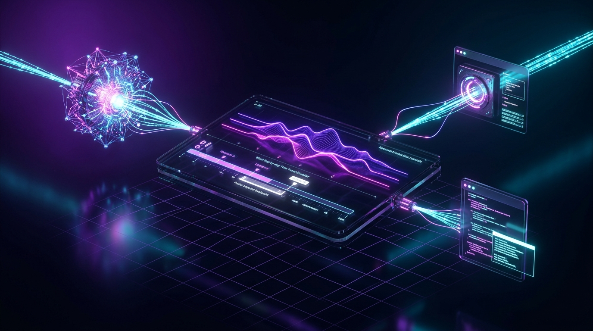

<div align="center">

  <a href="https://shenald-portfolio.vercel.app" target="_blank" rel="noopener noreferrer">
    
  </a>

  <br/><br/>

  

  <p><i>Turning caffeine, low-level streaming protocols, and foundation models into strictly-typed AI architectures.</i></p>

  <p>
    <a href="https://shenald-portfolio.vercel.app" target="_blank" rel="noopener noreferrer">
      
    </a>
    &nbsp;
    <a href="https://dev.to/shenald/we-measured-1500-lines-of-terminal-bloat-burning-020-per-prompt-in-cursor-heres-how-we-1a4" target="_blank" rel="noopener noreferrer">
      
    </a>
  </p>

  <p>
    <a href="https://github.com/shenald-dev"></a>
    <a href="https://github.com/shenald-dev"></a>
    <a href="https://github.com/shenald-dev"></a>
    <a href="https://github.com/shenald-dev"></a>
    <a href="https://github.com/shenald-dev"></a>
    <a href="https://github.com/shenald-dev"></a>
    <a href="https://github.com/shenald-dev"></a>
  </p>

</div>

---

## ⚡ The Shenald Autonomous AI Suite (The Big Three)

I engineer specialized, production-grade infrastructure for autonomous agents and developer flow. Below are my flagship tools published and maintained for the AI ecosystem:

<br/>

### 1. ⚡ [agentwire](https://github.com/shenald-dev/agentwire) — The Wireshark & Time-Travel Debugger for AI Agents & MCP Workflows

<a href="https://github.com/shenald-dev/agentwire" target="_blank" rel="noopener noreferrer">
  
</a>

<p align="center">
  <a href="https://www.npmjs.com/package/@shenald/agentwire"></a>
  <a href="https://github.com/shenald-dev/agentwire"></a>
  <a href="https://github.com/shenald-dev/agentwire"></a>
</p>

* **🔴 Real-Time MCP Stream Wiretap:** Passively taps stdio and SSE message frames between agents and tool servers without intrusive instrumentation.
* **🛑 Dangerous Command Breakpoints:** Intercepts high-risk shell executions (`rm -rf`, production drops, credential access) and pauses execution for human approval.
* **⏱️ Token Waterfall & Time-Travel Replay:** Step forward and backward through agent trajectories in a sleek, dark-mode web UI.

```bash
# Launch agentwire inspector with any MCP server
npx @shenald/agentwire npx -y @modelcontextprotocol/server-filesystem ./workspace
```

<br/>

### 2. 🔍 [termlens](https://github.com/shenald-dev/termlens) — Zero-Token Terminal Compactor & Semantic Error Lens

<a href="https://github.com/shenald-dev/termlens" target="_blank" rel="noopener noreferrer">
  
</a>

<p align="center">
  <a href="https://www.npmjs.com/package/termlens"></a>
  <a href="https://dev.to/shenald/we-measured-1500-lines-of-terminal-bloat-burning-020-per-prompt-in-cursor-heres-how-we-1a4"></a>
  <a href="https://github.com/shenald-dev/termlens"></a>
</p>

* **📉 Strips 97.3% of Terminal Bloat in <2.5ms:** Eliminates progress spinners, passing tests, and bloated `node_modules` stacks before they flood your LLM attention window.
* **🧠 Specialized Semantic Lenses:** Native AST-aware pattern decoders for Jest, Vitest, TypeScript (`tsc`), Pytest, Docker, and Cargo.
* **🔌 Native Model Context Protocol (MCP) Server:** Plug directly into Cursor, Claude Code, and Claude Desktop via `termlens --mcp`.

```bash
# Zero-install execution on any command
npx termlens npm test
```

<br/>

### 3. 🌱 [bonsai](https://github.com/shenald-dev/bonsai) — Zero-Knowledge Local Micro-Model Distiller

<a href="https://github.com/shenald-dev/bonsai" target="_blank" rel="noopener noreferrer">
  
</a>

<p align="center">
  <a href="https://github.com/shenald-dev/bonsai"></a>
  <a href="https://github.com/shenald-dev/bonsai"></a>
  <a href="https://github.com/shenald-dev/bonsai"></a>
</p>

* **🌿 Pocket Intelligences on Consumer Silicon:** Distills large reasoning foundation models into compact 0.5B–1.5B edge models in under 35 seconds.
* **🛡️ Zero-OOM Guard & Holdout Proof Engine:** Dynamic memory allocation and blind holdout validation ensuring mathematically verified task retention without GPU crashes.

---

## 🏛️ Autonomous Infrastructure Lifecycle

Here is how the toolchain connects to eliminate hallucination, monitor security, and drastically lower LLM inference costs:

```
                  ┌───────────────────────────────────────────────┐
                  │       Autonomous Coding Agent (Cursor / CLI)  │
                  └───────────────────────┬───────────────────────┘
                                          │ executes tool call / CLI command
                                          ▼
┌─────────────────────────────────────────────────────────────────────────────────┐
│  ⚡ agentwire (Inspection, Safety & Time-Travel Layer)                          │
│  [ Real-Time MCP Wiretap ] ──► [ Dangerous Command Trap ] ──► [ Token Waterfall]│
└─────────────────────────────────────────┬───────────────────────────────────────┘
                                          │ raw CLI stdout / stderr
                                          ▼
┌─────────────────────────────────────────────────────────────────────────────────┐
│  🔍 termlens (Context Density & Compaction Engine)                              │
│  [ Linear ANSI Stripper ] ──► [ Bounded Ring Buffer ] ──► [ Semantic Lenses ]   │
└─────────────────────────────────────────┬───────────────────────────────────────┘
                                          │ -97.3% noise stripped (<100 tokens failure)
                                          ▼
                  ┌───────────────────────────────────────────────┐
                  │       Target LLM / bonsai Edge Model          │
                  └───────────────────────────────────────────────┘
```

---

## 🚀 Full Open-Source Fleet

### Autonomous Systems & AI Architecture

| Repository | Description | Tech Stack |
| :--- | :--- | :--- |
| ⚡ **[agentwire](https://github.com/shenald-dev/agentwire)** | **The Wireshark & Time-Travel Debugger for AI Agents** `(@shenald/agentwire)`. Real-time MCP wiretap, safety breakpoints, token waterfalls, and time-travel replay. | `TypeScript`, `Node.js`, `MCP`, `SSE` |
| 🔍 **[termlens](https://github.com/shenald-dev/termlens)** | **Zero-Token Terminal Compactor & Semantic Error Lens** *(Published on npm)*. Strips 97.3% terminal noise in <2.5ms, isolates root causes, and exposes native MCP tools for Claude & Cursor. <br/>📖 **[Read Case Study on DEV.to](https://dev.to/shenald/we-measured-1500-lines-of-terminal-bloat-burning-020-per-prompt-in-cursor-heres-how-we-1a4)** | `TypeScript`, `Node.js`, `MCP`, `PTY` |
| 🌱 **[bonsai](https://github.com/shenald-dev/bonsai)** | **Zero-Knowledge Local Micro-Model Distiller**. Cultivates massive foundation models into pocket-sized edge models (0.5B–1.5B) on consumer PCs in <35s. Zero-OOM guard. | `Python`, `PyTorch`, `PEFT`, `Typer` |
| 🌌 **[SHEN AI](https://github.com/shenald-dev/shen-ai)** | **Autonomous Coding Agent**. A multi-agent AI assistant that predicts developer intentions, adapts to coding style, and executes multi-file workflows inside VS Code. | `TypeScript`, `React`, `Anthropic/OpenAI` |
| 🛡️ **[AgentForge](https://github.com/shenald-dev/agentforge)** | **Autonomous Full-Stack App Builder** `(@shenald/agentforge)`. Prompt-to-Next.js 15, FastAPI, Docker Compose & CI/CD pipelines in seconds with Mermaid architecture planner. | `TypeScript`, `Handlebars`, `OpenRouter API` |
| 🤖 **[AutoResearch-Agent](https://github.com/shenald-dev/autoresearch-agent)** | **Modular AI Research Agent** `(@shenald/autoresearch-agent)`. Autonomous research CLI powered by LangChain that scours the web to produce verified deep-dive reports. | `TypeScript`, `LangChain`, `OpenAI` |
| 🧬 **[CodeDNA](https://github.com/shenald-dev/codedna)** | **Software Intelligence Analyzer**. Reverse-engineers complex repositories to generate interactive architectural DNA profiles, dependency graphs, and complexity metrics. | `Python`, `NetworkX`, `Mermaid` |
| 💬 **[AI WhatsApp Intelligence](https://github.com/shenald-dev/ai-whatsapp-intelligence)** | **Real-Time Group Chat Monitor**. Automated intelligence system tracking live group threads, extracting sentiment, tasks, and trends with vector memory. | `FastAPI`, `Next.js`, `LangChain` |
| ⚡ **[one-api](https://github.com/shenald-dev/one-api)** | **Universal Edge LLM Gateway**. Single binary, zero-config API gateway routing inferences to 20+ top-tier LLM providers with unified billing and fallback. | `TypeScript`, `Hono.js`, `Vercel Edge` |

<br/>

### High-Performance Developer Tooling & Mechanics

| Repository | Description | Tech Stack |
| :--- | :--- | :--- |
| 🧹 **[purge](https://github.com/shenald-dev/purge)** | **Developer Bloat & Zombie Reaper**. Parallel directory scanner and dev server hunter. Purges `node_modules`, `target`, `.venv`, and slays port hogs on `:3000` in 3 seconds. | `Python`, `Typer`, `Rich`, `psutil` |
| 💎 **[prism](https://github.com/shenald-dev/prism)** | **Topological Blast Radius Radar**. Zero-latency (<50ms) topological call-graph & contract invariant analyzer. Pinpoints every broken downstream caller caused by AI edits. | `Python`, `Typer`, `Rich`, `AST` |
| 🍸 **[sober](https://github.com/shenald-dev/sober)** | **The Vibe Coding Hangover Cure**. Ultra-fast (<500ms) zero-config CLI auditing AI hallucinations, ghost code, secret leaks, and slopsquatting before production. | `Python`, `Typer`, `Rich` |
| 🧠 **[catalyst](https://github.com/shenald-dev/catalyst)** | **Parallel DAG Workflow Engine**. Executes highly complex data pipelines using strictly-typed Domain-Driven Design in Python. Includes benchmarking. | `Python`, `FastAPI`, `NetworkX` |
| 🎭 **[moq](https://github.com/shenald-dev/moq)** | **Zero-Config Mock Server**. Lightning-fast Express-based server to instantly mock REST endpoints during frontend development without configuration friction. | `TypeScript`, `Express` |
| 🧘‍♂️ **[zen](https://github.com/shenald-dev/zen)** / **[echo](https://github.com/shenald-dev/echo)** | **Minimalist Developer Toolbelt**. Deep-work terminal timers and ultra-lightweight zero-config file watchers to keep your CLI vibe undisturbed. | `Python`, `Bash` |
| ✨ **[vibe](https://github.com/shenald-dev/vibe)** | **Minimalist Project Scaffolding Engine**. Generates beautifully tuned full-stack templates instantly via a visually stunning TUI without writing boilerplate. | `Python`, `Typer`, `Rich` |

---

## 📊 Telemetry & Live Metrics

<div align="center">
  
</div>

<br />

<div align="center">
  <picture>
    <source media="(prefers-color-scheme: dark)" srcset="https://raw.githubusercontent.com/shenald-dev/shenald-dev/output/github-contribution-grid-snake-dark.svg">
    <source media="(prefers-color-scheme: light)" srcset="https://raw.githubusercontent.com/shenald-dev/shenald-dev/output/github-contribution-grid-snake.svg">
    
  </picture>
</div>

<br />

<div align="center">
  
  
</div>

---

<div align="center">
  <h3>⚡ Step inside the interactive 3D developer sandbox</h3>
  <p>Experience real-time AST invariant radars, parallel reapers, and spatial AI architectures:</p>
  <a href="https://shenald-portfolio.vercel.app" target="_blank" rel="noopener noreferrer">
    
  </a>
  <br /><br />
  <i>Built with intention & strictly typed.</i> 🧘‍♂️✨ Let's connect on <a href="https://github.com/shenald-dev">GitHub</a> or explore my spatial profile at <a href="https://shenald-portfolio.vercel.app"><b>shenald-portfolio.vercel.app</b></a>.
</div>
